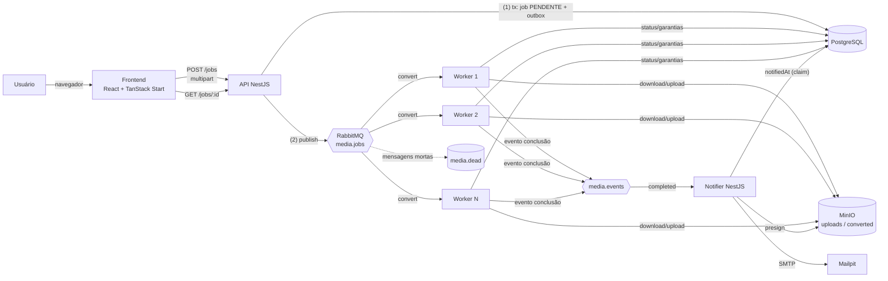

# Arquitetura, contratos e diagramas

## Diagrama de componentes



## Diagrama de sequência (caminho feliz)

```mermaid
sequenceDiagram
    autonumber
    participant FE as Frontend
    participant API as API
    participant PG as Postgres
    participant MQ as RabbitMQ
    participant W as Worker (Nº N)
    participant S3 as MinIO
    participant NO as Notifier
    participant MP as Mailpit

    FE->>API: POST /jobs (arquivo, targetFormat, notifyEmail)
    API->>API: valida e-mail + magic bytes + compatibilidade
    API->>S3: PutObject uploads/{uuid}/original.{fmt}
    API->>PG: BEGIN: INSERT job (PENDENTE) + outbox; COMMIT
    API-->>FE: 202 Accepted {jobId}   ← sem esperar conversão

    loop relay de outbox (todos os processos)
        API->>MQ: publish ConversionRequested (persistent)
        API->>PG: outbox.publishedAt = now
    end

    MQ->>W: entregue (prefetch 1, manual ack)
    W->>PG: UPDATE set PROCESSANDO WHERE status=PENDING
    W->>S3: GetObject original
    W->>W: ffmpeg (vídeo/áudio) ou sharp (imagem)
    W->>S3: PutObject converted/{jobId}/result.{fmt}
    W->>PG: BEGIN: UPDATE CONCLUÍDO + outbox evento; COMMIT
    W->>S3: RemoveObject original (após resultado confirmado)
    W-->>MQ: ack

    loop relay
        W->>MQ: publish ConversionCompleted
    end
    MQ->>NO: entregue
    NO->>PG: UPDATE notifiedAt WHERE notifiedAt IS NULL (claim único)
    NO->>S3: presign GET converted/{jobId}/result.{fmt} (30 min)
    NO->>MP: sendMail (link)
    NO-->>MQ: ack

    loop periodicamente (a cada 3 s)
        FE->>API: GET /jobs/:jobId
        API-->>FE: status / downloadUrl / errorMessage
    end
```

## Contratos das mensagens (fila)

Fila `media.convert`, exchange `media.jobs` (direct, key `convert`), mensagens persistentes (`deliveryMode: 2`), JSON. Dead-lettering: `x-dead-letter-exchange: media.jobs.dlx`, key `dead`, fila `media.dead`.

### `ConversionRequested` (API → workers)

| Campo | Tipo | Descrição |
|---|---|---|
| `jobId` | string (uuid) | chave de idempotência |
| `objectKey` | string | objeto do original em `uploads` |
| `sourceType` | `video \| audio \| image` | detectado por magic bytes |
| `sourceFormat` | string | formato detectado |
| `targetFormat` | string | destino validado contra whitelist |
| `notifyEmail` | string | e-mail da notificação |
| `requestedAt` | string (ISO 8601) | carimbo |
| `attempt` | number | contador de entrega (informativo; fonte de verdade é o DB) |

`{ "jobId": "…", "objectKey": "…/original.png", "sourceType": "image", "sourceFormat": "png", "targetFormat": "webp", "notifyEmail": "a@b.dev", "requestedAt": "2026-01-01T00:00:00.000Z", "attempt": 0 }`

Regra dura: **binário nunca entra na fila** — o payload carrega apenas metadados (~300 bytes).

### `ConversionCompleted` (workers → notifier)

| Campo | Tipo |
|---|---|
| `jobId` | string (uuid) |
| `resultKey` | string (`{jobId}/result.{fmt}` em `converted`) |
| `notifyEmail` | string |
| `completedAt` | string (ISO 8601) |

## Contrato de API

- `POST /jobs` — multipart (`file`, `targetFormat`, `notifyEmail`) → `202 {jobId}`; erros `400 {message}`.
- `GET /jobs/:jobId` — `200 {jobId, status, targetFormat, downloadUrl?, errorMessage?, createdAt, updatedAt}`; `status ∈ {PENDENTE, PROCESSANDO, CONCLUÍDO, ERRO}`; `404` se inexistente.

## Garantias e idempotência (resumo operacional)

| Risco | Tratamento |
|---|---|
| API grava job e falha antes de publicar | Transactional Outbox: mensagem nasce na mesma transação; relay publica depois |
| Mensagem entregue duplicada | Worker: se job já `CONCLUÍDO`/`ERRO`, ack sem efeito (idempotente por `jobId`); resultado gravado em chave determinística `{jobId}/result.{fmt}` |
| Worker morre com mensagem não-ack | Fila reentrega; claim `PENDING→PROCESSANDO` permite reprocessar um job semi-feito (gravação é atômica na transação) |
| Notificação duplicada | `notifiedAt` com UPDATE condicional — apenas um consumidor ganha o direito de enviar |
| Falha temporária (infra) | até `MAX_ATTEMPTS` reentregas, backoff fixo de 2 s |
| Falha definitiva | `ERRO` no DB, original preservado, mensagem → DLQ (`media.dead`) |
| Perde exatamente-once | não há: o design aceita at-least-once + idempotência nos efeitos |
